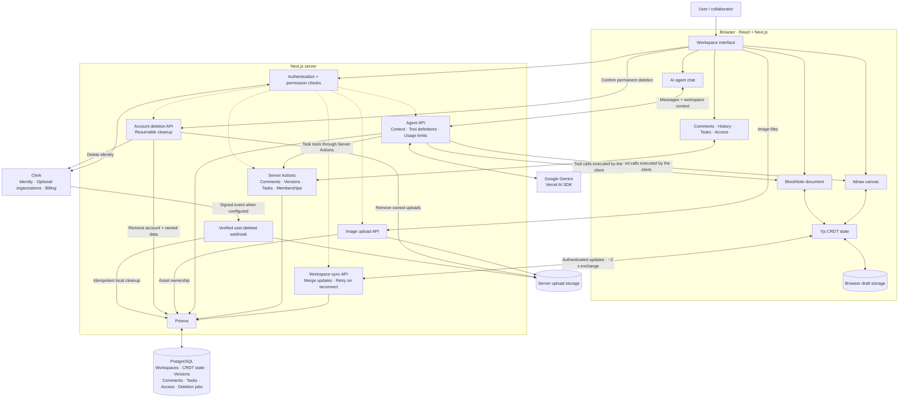

<div align="center">

# DraftLane

### From rough ideas to shared direction.

An AI workspace for diagrams, documents, and actionable plans — built to keep your thinking connected.

**Canvas · Documents · AI collaboration · Offline recovery**

[Features](#features) · [Architecture](#architecture-diagram) · [Quick start](#quick-start) · [Collaboration](#collaboration--recovery) · [Testing](#testing) · [Project structure](#project-structure)


*Sketch the idea. Shape the plan. Build together.*

</div>

---

## Overview

DraftLane brings an infinite canvas, a structured document editor, and an AI collaborator into one workspace. Map a system, turn the diagram into a specification, and extract the implementation tasks without moving between separate tools.

Start with a prompt, refine the result yourself, and bring other people into the same workspace with the access they need.

## Features

| Capability | What you can do |
| --- | --- |
| **Visual canvas** | Create diagrams, flowcharts, text, images, and editable ERD tables with connected relationships. |
| **Structured documents** | Write specifications, notes, checklists, tables, and code alongside your diagram. |
| **AI that edits the workspace** | Ask the agent to create or update actual canvas objects and document blocks. New diagrams are placed clear of existing artwork. |
| **Workspace organization** | Start from a typed or voice prompt, revisit recent workspaces, and organize projects on a kanban board. |
| **Sharing and export** | Grant workspace access, publish read-only links, and export documents or canvases to PDF where the owner's plan allows it. |
| **Account control** | Delete individual workspaces or permanently delete your account and its associated data. |

### Collaboration features

These additions take DraftLane beyond a drawing-and-document editor:

| Feature | How it works in DraftLane |
| --- | --- |
| **Offline editing and reconnection** | Document and canvas edits apply locally, are cached in the browser, and retry synchronization when the connection returns. |
| **Version history and restore** | Keep named versions, automatic checkpoints, and snapshots before AI changes. Restore the document, canvas, and tasks with a backup of the current state. |
| **Anchored comments** | Attach a discussion to a selected canvas object, a document block, or the workspace. Jump to references and resolve or reopen threads. |
| **Canvas → roadmap → tasks** | Turn a board into a phased document roadmap and a persistent implementation-task list. Track tasks through To do, In progress, and Done. |
| **Workspace permissions** | Give people Viewer, Commenter, or Editor access. Owners and organization administrators manage access. |

## Try the workflow

1. **Describe the idea.** Create a workspace with a prompt such as “Design a food-delivery database and document it.”
2. **Refine the output.** Edit the canvas and document yourself, or ask the agent for targeted changes.
3. **Make it actionable.** Open **Activity → Tasks** and choose **Canvas → roadmap** or **Extract tasks**.
4. **Review together.** Add comments and grant collaborators the appropriate access.
5. **Keep a recovery point.** Save a named version in **Activity → History** before a major revision.

<details>
<summary><strong>Example AI requests</strong></summary>

- “Draw a CRUD architecture for a task-management app.”
- “Explain this diagram in the document.”
- “Turn these notes into a phased roadmap and create implementation tasks.”
- “Extract a checklist from the canvas without changing the diagram.”
- “Update only the document with the API requirements.”

</details>

## Tech stack

| Layer | Technology |
| --- | --- |
| Application | Next.js 16, React 19, TypeScript |
| Canvas | tldraw with custom ERD shapes |
| Documents | BlockNote |
| Synchronization | Yjs CRDTs over authenticated workspace endpoints |
| Database | PostgreSQL and Prisma |
| AI | Google Gemini through the Vercel AI SDK |
| Identity and billing | Clerk, optional Organizations, Clerk Billing |
| Interface | Tailwind CSS 4, shadcn/ui, Radix UI, Lucide |

## Architecture diagram

The browser edits locally; authenticated server endpoints synchronize shared state and enforce workspace permissions.



- **Editing:** canvas and document changes update locally first, then synchronize through the permission-checked API. Browser drafts support recovery after a disconnection.
- **AI:** Gemini receives workspace context and returns structured tool calls. Canvas/document tools run against the live editors; task tools persist through authorized server operations.
- **Persistence and recovery:** Prisma stores merged state, comments, tasks, access rules, and version snapshots in PostgreSQL. Restore generations reject outdated saves.
- **Identity and deletion:** Clerk handles identity. The app coordinates identity deletion, database cleanup, and uploaded-file removal; signed webhooks cover external Clerk deletions when configured.

## Quick start

### Prerequisites

- Node.js 22 or later and npm.
- A running PostgreSQL database.
- A Clerk application for authentication.
- A Google AI API key to enable the workspace agent.

### 1. Install the project

```bash
git clone https://github.com/ratuhin1122/DraftLane.git
cd DraftLane
npm install
```

The installation also generates the Prisma client.

### 2. Configure the environment

Copy [.env.example](.env.example) to `.env` and fill in your own values.

```bash
cp .env.example .env
```

On Windows PowerShell:

```powershell
Copy-Item .env.example .env
```

| Variable | Purpose |
| --- | --- |
| `NEXT_PUBLIC_CLERK_PUBLISHABLE_KEY` | Clerk browser configuration. |
| `CLERK_SECRET_KEY` | Clerk server authentication and account operations. |
| `DATABASE_URL` | PostgreSQL connection used by the application. |
| `DIRECT_URL` | Connection used for Prisma migrations; it can match `DATABASE_URL` for a local database. |
| `GOOGLE_GENERATIVE_AI_API_KEY` | Enables AI responses and workspace tools. |
| `GOOGLE_GENERATIVE_AI_MODEL` | Optional model override; the current default is `gemini-3.5-flash-lite`. |
| `NEXT_PUBLIC_CLERK_ORGANIZATIONS_ENABLED` | Set to `true` only after enabling Organizations in Clerk. Defaults to off. |
| `NEXT_PUBLIC_TLDRAW_LICENSE_KEY` | Canvas license configuration for your deployment. |
| `CLERK_WEBHOOK_SIGNING_SECRET` | Optional verified cleanup for accounts deleted directly through Clerk. |

The Clerk redirect variables are included in the example file. Supabase and the public tldraw demo server are **not required** for the current document/canvas sync path.

### 3. Apply database migrations

```bash
npx prisma migrate deploy
```

If you keep your configuration in `.env.local` instead, load that file explicitly for the migration command:

```bash
node --env-file=.env.local node_modules/prisma/build/index.js migrate deploy
```

### 4. Start DraftLane

```bash
npm run dev
```

Open the local URL printed by Next.js, normally [http://localhost:3000](http://localhost:3000). To use port 3001:

```bash
npm run dev -- --port 3001
```

The Windows helper `npm run db:start` starts an **existing** database in `.local/postgres` on port 55432. It does not initialize or reset a database. Keep database files outside `node_modules`.

## Collaboration & recovery

### Synchronization

- **Documents:** Yjs merges text edits and deletions.
- **Canvas:** each object is a separate CRDT register. Independent object edits merge; concurrent changes to the same object resolve deterministically.
- **Transport:** authenticated requests exchange updates about every two seconds and retry failed writes. Local editing does not wait for a network round trip.
- **Draft recovery:** browser storage retains edits while disconnected. Do not clear site data before pending changes synchronize.

Canvas properties use object-level conflict resolution, rather than merging individual characters inside a shape. Image uploads, AI requests, comments, task changes, and access changes require a connection.

### History and restore

Open **Activity → History** to save a named version or restore an earlier one. Automatic checkpoints are created during editing, and the agent saves a snapshot before making changes.

A restore brings back the document, canvas, and tasks. It first backs up the current state, retains comments and access settings, and starts a new workspace generation. Connected editors reload; saves from an older generation are rejected.

### Access levels

| Role | View | Comment | Edit content, tasks, and versions | Manage access |
| --- | :---: | :---: | :---: | :---: |
| Viewer | ✓ | — | — | — |
| Commenter | ✓ | ✓ | — | — |
| Editor | ✓ | ✓ | ✓ | — |
| Owner / manager | ✓ | ✓ | ✓ | ✓ |

Add a collaborator by email in **Activity → Access** after they have signed in to DraftLane once. Their shared workspace appears on their dashboard; no invitation email is sent. Organization membership can also grant access.

Public sharing links show the last saved, read-only content. Invited, signed-in collaborators use the live workspace.

## Account and workspace management

- **Delete a workspace:** use the trash button on a recent-workspace card or the board's workspace menu. A confirmation is required.
- **Delete an account:** choose **Profile menu → Delete account** and type `DELETE` to confirm. The flow removes the Clerk identity, local account, owned workspace data, comments, memberships, prompt records, and tracked uploads. Other people's workspaces remain, and historical attribution is anonymized.
- **Retry interrupted deletion:** the account page keeps a deletion receipt so cleanup can resume after a provider, file, or database failure.

To handle deletion performed outside DraftLane, configure Clerk's `user.deleted` webhook at `/api/webhooks/clerk` and supply `CLERK_WEBHOOK_SIGNING_SECRET`. The app's own deletion flow works without webhook setup.

## Plans and deployment

The free-plan defaults are **3 owned workspaces** and **20 agent prompts per month**. Paid capabilities come from your Clerk configuration.

<details>
<summary><strong>Clerk feature keys</strong></summary>

| Key | Capability |
| --- | --- |
| `unlimited_workspaces` | Removes the free workspace limit. |
| `public_sharing` | Enables public read-only links. |
| `pdf_export` | Enables PDF export. |
| `agent_prompts_500` | Enables the corresponding prompt allowance. |
| `agent_prompts_2000` | Enables the higher prompt allowance. |

Enable Organizations with **membership optional** if you want both personal and team workspaces. Configure billing plans and checkout in Clerk; displayed prices come from that configuration.

</details>

For deployment, configure the environment on your host, provide PostgreSQL, apply migrations, and run a production build. The current upload implementation writes to `public/uploads`, so use persistent storage or adapt uploads to object storage on hosts with ephemeral filesystems. Configure your canvas license, Clerk production settings, and deletion webhook for the deployed environment.

## Testing

```bash
npm run lint
npm test
npm run build
```

Regression coverage includes offline reconnect, three-client CRDT convergence, conflict resolution, draft recovery, role permissions, image sizing, agent placement, and a 1,000-object canvas-state round trip.

Database integration tests also cover saved-state persistence, version/task restore, stale-save rejection, and retryable account deletion.

For integration tests, use a **separate disposable PostgreSQL database**. Set `DATABASE_URL`, `DIRECT_URL`, and `TEST_DATABASE_URL` to that test database, apply migrations there, then run:

```bash
npm run test:integration
```

The tests create and remove their own fixtures. Never use a production database for integration tests.

## Project structure

```text
app/
  page.tsx                    Landing page
  (main)/dashboard/           Prompt entry and recent workspaces
  (main)/workspaces/          Workspace board
  (main)/workspace/[id]/      Canvas, document, agent, and activity
  (main)/account/             Permanent account deletion
  shared/[token]/            Public read-only workspace
  api/agent/                 AI streaming and workspace tools
  api/workspaces/[id]/sync/   Authenticated CRDT synchronization
  api/account/               Account-deletion workflow
  api/webhooks/clerk/         Verified identity-deletion events

actions/                     Authorized workspace operations
components/                  Shared interface and editor components
hooks/                       Collaborative documents and agent chat
lib/                         CRDTs, persistence, permissions, history, and cleanup
prisma/                      Schema and database migrations
public/videos/               Walkthrough video, GIF, and poster
scripts/                     Local database and media helpers
tests/                       Regression and database integration tests
```

## Commands

| Command | Purpose |
| --- | --- |
| `npm run dev` | Start the development server. |
| `npm run build` | Build for production. |
| `npm run start` | Serve the production build. |
| `npm run lint` | Run ESLint. |
| `npm test` | Run regression tests. |
| `npm run test:integration` | Run isolated database tests. |
| `npm run db:start` | Start the existing local Windows PostgreSQL instance. |
| `npm run seed -- you@example.com [org_id]` | Add demo workspaces after signing in once. |

## License

The project declares **GPL-3.0-only** in [package.json](package.json).
